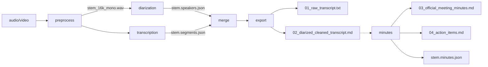

# جریان داده (Data Flow)

| وضعیت | آخرین به‌روزرسانی | مالک |
| :--- | :--- | :--- |
| فعال | 1405-07-27 | Engine |



## ۱. مرحله‌به‌مرحله

| # | مرحله | ورودی | عملیات | خروجی | رویدادها |
| :---: | :--- | :--- | :--- | :--- | :--- |
| ۱ | `preprocess` | فایل صوتی/ویدیویی هر فرمت | FFmpeg: مونو، ۱۶kHz، PCM 16-bit + زنجیرهٔ فیلتر `highpass=60, lowpass=7800, loudnorm(I=…, TP=-1.5, LRA=11)` | `<stem>_16k_mono.wav` | `stage` ۰→۱ با ETA |
| ۲ | `diarization` | WAV پیش‌پردازش‌شده | segmentation (PyAnnote) → امبدینگ (WeSpeaker/3D-Speaker) → خوشه‌بندی با انتخاب K (یا K ثابت کاربر) | `<stem>.speakers.json`, `<stem>.speakers.txt` | `stage` پیشرفت بلوکی |
| ۳ | `transcription` | WAV پیش‌پردازش‌شده | Whisper `large-v3-turbo`، word timestamps، VAD | `<stem>.segments.json/.jsonl/.txt/.srt` | `stage` از روی `end/duration` |
| ۴ | `merge` | segments + speakers | برای هر واژه: گویندهٔ دارای بیشترین هم‌پوشانی؛ گروه‌بندی واژه‌های پیوستهٔ یک گوینده در یک utterance | در حافظه + `<stem>_transcript.json` | `stage` ۰→۱ |
| ۵ | `export` | utterances + speaker map | پالایش فارسی (نیم‌فاصله، واژه‌نامه)، اعمال نام گویندگان، رندر | `01_raw_transcript.txt`, `02_diarized_cleaned_transcript.{txt,md}` | یک `artifact` برای هر فایل |
| ۶ | `minutes` ✅ M3a | `<stem>_transcript.json` (utteranceهای شاهد) | قطعه‌بندی، فراخوانی LLM (استخراج + ادغام محلی)، اعتبارسنجی شاهد، رندر | `03_official_meeting_minutes.md`, `04_action_items.md`, `<stem>.minutes.json` | `stage: minutes` + یک `artifact` برای هر فایل |

## ۲. قواعد ادغام (merge)

1. **هم‌پوشانی زمانی مرجع است**، نه ترتیب: برای هر واژه، گویندهٔ بازهٔ دارای بیشترین اشتراک زمانی انتخاب می‌شود.
2. **گروه‌بندی جملات:** واژه‌های پیاپی با گویندهٔ یکسان در یک utterance جمع می‌شوند؛ فاصلهٔ زمانی بزرگ‌تر از آستانه، utterance را می‌شکند.
3. **بدون نتیجهٔ دیاریزیشن:** متن حفظ می‌شود و همه در یک utterance با گویندهٔ ۰ قرار می‌گیرند (خروجی هرگز خالی نمی‌شود).
4. **نگاشت نام:** `speaker_map[<id>].name` و `.role` روی برچسب گوینده اثر می‌گذارند؛ کلیدهای اضافی نادیده گرفته می‌شوند.

## ۳. پیش‌پردازش متن فارسی

| عمل | نمونه |
| :--- | :--- |
| نیم‌فاصله پیشوند/پسوند فعل | `می روم` ⇒ `می‌روم` |
| نیم‌فاصلهٔ جمع | `کتاب ها` ⇒ `کتاب‌ها` |
| اصلاح واژگان تخصصی | `دیتا بیس` ⇒ `دیتابیس` (از `glossary_fa.json`) |
| جمع‌کردن فاصله‌های اضافی | `سلام    دنیا` ⇒ `سلام دنیا` |

واژه‌نامه قابل‌ویرایش است: `engine/minutemate/resources/glossary_fa.json` (بدون تغییر کد).

## ۴. مسیر فایل‌ها در لایهٔ داده

در وضعیت فعلی همهٔ خروجی‌ها در `--out-dir` مسطح و با پیشوند `--stem` نوشته می‌شوند. ساختار هدف (⏳ M2):

```
data/sessions/<YYYY-MM-DD>-<slug>/
├── raw/    فایل اصلی بدون تغییر
├── work/   stem_16k_mono.wav, stem.segments.*, stem.speakers.*
├── out/    01_…, 02_…, 03_…, 04_…
└── session.json
```

## ۵. حجم و زمان (نمونهٔ واقعی)

| ورودی | خروجی WAV | زمان دیاریزیشن | زمان ASR (CPU int8) | توضیح |
| :--- | :--- | :--- | :--- | :--- |
| ۳۰ ثانیه، ۱۶kHz مونو | ~۱ MB | ~۵ ثانیه | ~۱۶ ثانیه | اجرای تست دود روی CPU |

مقیاس‌پذیری و اهداف زمان در [`../03-operations/performance.md`](../03-operations/performance.md).
